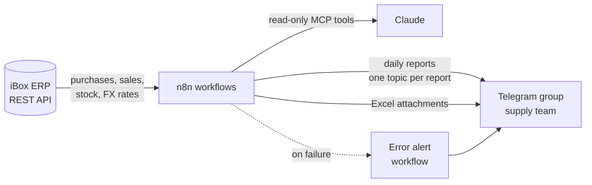

# n8n ERP Automation — AI Procurement Agent & Claude MCP Server

Production n8n workflows I built for my own construction-materials distribution company (multiple branches and warehouses).
They connect the company's ERP (**iBox**) to the supply team's Telegram group and to **Claude** via MCP.

All workflows run daily in production. This repository contains **sanitized exports**: hosts, branch names,
warehouse IDs, chat IDs and credentials are replaced with placeholders.

## Workflows

| # | Workflow | What it does |
|---|----------|--------------|
| 1 | [`01-purchase-price-analysis.json`](workflows/01-purchase-price-analysis.json) | Every evening, checks each newly received purchase against the previous price and a 90-day weighted average. Flags overpaid items (with total overpayment), suspiciously cheap items, and likely data-entry errors (price ×2 or ÷2). |
| 2 | [`02-dead-stock-monitor.json`](workflows/02-dead-stock-monitor.json) | Every morning, finds stock that hasn't sold for 50+ days, values the frozen money, compares with yesterday (what left the list and why, what was added), and sends a full Excel list once a week. |
| 3 | [`03-ibox-mcp-server-for-claude.json`](workflows/03-ibox-mcp-server-for-claude.json) | MCP server that gives Claude three **read-only** tools on live ERP data: ABC analysis, stock lookup, and a guarded GET explorer. |
| 4 | [`04-error-alert.json`](workflows/04-error-alert.json) | Global error workflow: when any report fails, sends a Telegram alert with the failed node and a plain-language hint (rate limit, expired token, timeout, bot permissions). |

## Engineering details worth noting

**Reliability**
- Full pagination over the ERP API (first page → page count → batched requests with intervals to respect rate limits).
- Retries with backoff on every HTTP node; non-critical calls (FX rate) continue on error.
- Data-completeness check before reporting: if sales history or stock pages are incomplete, the dead-stock report says so instead of sending wrong numbers.
- A dedicated error workflow, so a failed report is never silent.

**Correctness**
- Only received documents are analysed (drafts and pending documents are excluded and counted separately).
- Each purchase document is checked exactly once, tracked in workflow static data, even if it is approved days after it was drafted.
- Prices use the discounted line total, not the list price; USD and UZS are normalised using the median of recent ERP exchange rates.
- Telegram's 4096-character limit is handled by splitting reports into chunks.

**Safe AI access (MCP)**
- Claude gets purpose-built tools instead of raw API access.
- The generic `ibox_get` tool is restricted to GET, one host, and the `/api/integration/` path, with input validation.
- Large responses are truncated, and ABC results are cached for the day so repeated questions are instant.

## Example questions Claude can answer through the MCP server
- "Which A-category products are running low?"
- "What's the current stock of Knauf plasterboard?"
- "Show the top 20 products by sales over the last 90 days, by brand."

## Setup
1. Import a workflow JSON in n8n (**Workflows → Import from file**).
2. Create credentials: **Header Auth** for the iBox API, **Telegram API** for the bot, **Bearer Auth** for the MCP trigger.
3. Replace every `REPLACE_ME` credential and fill the **Sozlamalar** (Settings) node: host, branch ID, warehouse IDs, Telegram chat ID.
4. In workflows 1–2, set workflow 4 as the **Error workflow** in workflow settings.

> Node names and report texts are in Uzbek, because the reports are read by the supply team in Tashkent.
> Comments in the code are in English.

## Stack
n8n Cloud · JavaScript (Code nodes) · iBox ERP REST API · Telegram Bot API · Model Context Protocol · Claude

---
Built by **Nodirxo'ja Fayzullayev** — AI automation for real businesses.
